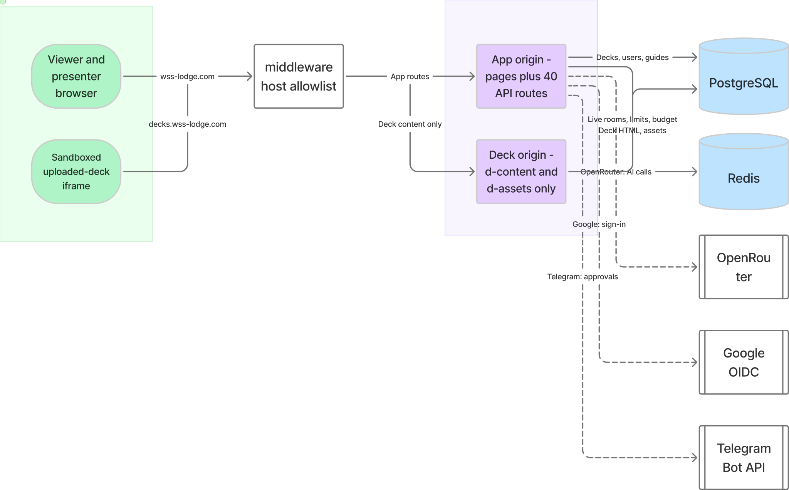
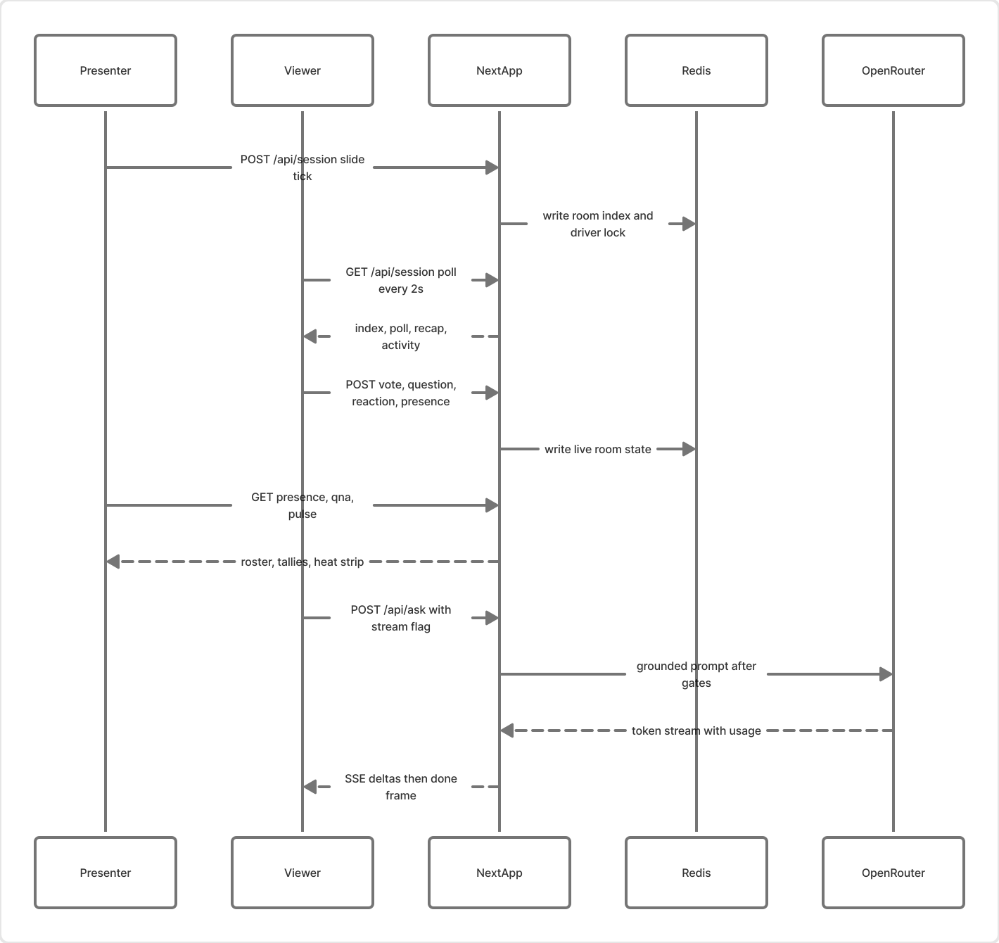
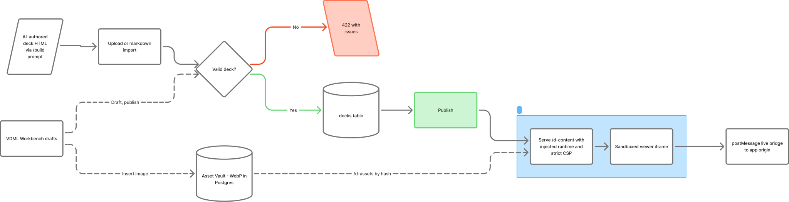
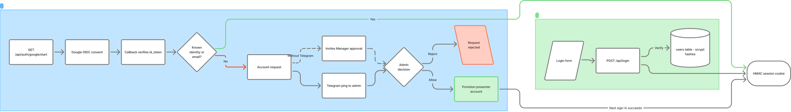

# VibeDeck

**A live workshop presentation platform** — AI-authored decks, real-time rooms, and a grounded AI tutor, self-hosted on Railway.

You present a deck; the room follows along on their phones. Polls, quizzes, Q&A, reactions, and an AI tutor grounded in the slides all run live. Uploaded decks are untrusted HTML, so they're validated on upload and served from an **isolated origin** (`decks.wss-lodge.com`) in sandboxed iframes — the app origin never executes deck code.



## Feature tour

### For viewers (no account, nothing to install)

| Feature | What it does |
|---|---|
| Live following | The deck on your phone tracks the presenter's slide; toggle off to browse freely |
| AI tutor | Ask about the current slide — streamed answers grounded in the deck (`/api/ask`, SSE) |
| Suggested questions | 2–3 AI-suggested starter questions per slide |
| Explain differently | One-tap reframes (ELI5, analogy, example, deeper) cached room-wide |
| Catch me up | Late joiners get an AI recap of the slides they missed |
| Polls & quizzes | Vote, see revealed tallies, read the AI "why that answer" explainer |
| Branch points | Vote on where the deck goes next (choose-your-own-path decks) |
| Q&A queue | Ask and upvote questions; see what's been answered |
| Reactions | 👍 🎉 🐢 🙋 and an "I'm lost" signal straight to the presenter |
| Turn & Talk | On-screen countdown for discussion breaks |
| Pinboard | Share your work-in-progress link to the class gallery |
| Study guide | A share-token handout page (`/study/<token>`) with download |
| Portfolio Builder | The workshop's hands-on slide: an AI interview that generates a complete single-file portfolio site |

### For the presenter

| Feature | What it does |
|---|---|
| Presenter console | Drive slides with a driver lock, timer, and presence roster |
| Insight Pulse | Per-slide confusion heat strip (questions, reframes, "I'm lost", wrong votes) + AI teaching debrief |
| Poll drafting | One click turns the current slide into a reviewed multiple-choice check |
| Q&A digest | AI clusters open questions into the top confusions |
| Room recap | Broadcast an AI recap overlay when the room gets lost |
| Deck upload / import | Upload validated deck HTML or import Markdown; decks live in Postgres |
| VDML Workbench | In-browser CodeMirror editor with draft/preview/publish lifecycle |
| Asset Vault | Images re-encoded to WebP (`sharp`) and stored in Postgres, served by content hash |
| AI grounding editor | Per-slide tutor context + speaker notes, with one-click AI drafting (review-before-save) |
| Study-guide generator | AI-drafted, presenter-curated, published to a share token |
| Session reset | One button wipes all live room state for a deck |
| `/build` | The canonical deck-authoring prompt (paste into any AI chat) |

### For the admin

| Feature | What it does |
|---|---|
| Password sign-in | scrypt-hashed accounts; the first admin is seeded from env |
| Google sign-in | OIDC; new emails become approval requests |
| Telegram approval | The admin gets an [Allow]/[Reject] ping for new account requests (works without Telegram too) |
| Invites | Mint single-use invite links with a fixed role |
| Publish control | `main` (the deck at `/`), `normal`, or `unpublished` per deck |
| AI budget | A daily token ceiling across every AI feature, with per-name and per-IP rate limits |

## Architecture

One Next.js 15 (App Router) service on Railway. Postgres and Redis attached; OpenRouter for all AI calls. No websockets — everything is short-poll REST except a single SSE stream for tutor answers.

- **Postgres** — decks + per-slide metadata, users/invites/identities/account requests, study guides, session reports, deck drafts, and the Asset Vault (WebP bytes as BYTEA). Forward-only migrations run **in-process** on first store access; there is no separate migrate step.
- **Redis (ioredis)** — the live layer: room index + driver lock, presence, polls + votes (Lua tallies), Q&A, reactions, confusion pulse, recap/activity slots, rate limits, and the AI budget + room caches. Every store degrades to an in-memory fallback when `REDIS_URL` is unset (single instance only).
- **OpenRouter** — one client ([lib/openrouter.ts](lib/openrouter.ts)) carries the headers, 45s abort bound, reasoning retry, and token accounting for all eleven AI features; routes keep their own gate ordering.
- **Two origins, one deployment** — [middleware.ts](middleware.ts) routes by Host header: the deck host answers *only* `/d-content/*` and `/d-assets/*` (everything else 404s by construction), and the app host refuses those paths. Uploaded decks render in sandboxed iframes with a strict CSP whose `frame-ancestors` points back at the app origin.





## Quick start (local dev)

Prereqs: Node (see [.nvmrc](.nvmrc)), npm.

```bash
npm install
npm run dev
```

The app is designed to boot with **nothing configured** and light up feature-by-feature:

| Unset | What still works | What you lose |
|---|---|---|
| `DATABASE_URL` | The built-in deck, live rooms, AI with static grounding | Uploads, Workbench, accounts beyond the seed, editing |
| `REDIS_URL` | Everything, via in-memory fallback | Multi-instance rooms; state survives restarts |
| `OPENROUTER_API_KEY` | All non-AI features | Every AI feature (endpoints report `ai_not_configured`) |
| `DECK_HOST` / `DECK_ORIGIN` | The built-in embed deck | Uploaded decks list but are flagged unavailable (fail closed) |
| `AUTH_SECRET` | Local dev (dev-only default) | **Required in prod — the app fails closed with 503s** |

`cp .env.example .env.local` and fill in what you need — [.env.example](.env.example) documents every variable. Pre-push gate:

```bash
npm run check
```

Two files are read from disk at request time — [VIBEDECK_PROMPT.md](VIBEDECK_PROMPT.md) (served at `/build`) and `runtime/vibedeck-v1.js` (injected into uploaded decks). The runtime file is **generated**: edit `public/decks/build-host-website/{deck-stage,bridge}.js` and run `npm run build:runtime` (the build does this automatically, and a test fails if the committed file drifts).

## Environment variables

Grouped exactly like [.env.example](.env.example) — see it for full per-variable notes. ★ = required in production. Only the two `NEXT_PUBLIC_*` values reach the browser.

| Group | Variables |
|---|---|
| Origins & hosts | `DECK_HOST`, `DECK_ORIGIN`, `APP_ORIGIN` |
| Auth & accounts | `AUTH_SECRET`★, `PRESENTER_USERNAME`, `PRESENTER_PASSWORD`, `GOOGLE_CLIENT_ID`, `GOOGLE_CLIENT_SECRET` |
| Telegram approval | `TELEGRAM_BOT_TOKEN`, `TELEGRAM_ADMIN_CHAT_ID`, `TELEGRAM_ADMIN_USER_ID`, `TELEGRAM_WEBHOOK_SECRET` |
| Postgres | `DATABASE_URL`, `DATABASE_PUBLIC_URL` (reference only), `DATABASE_CA_CERT`, `DATABASE_POOL_MAX` |
| Redis & live session | `REDIS_URL`, `NEXT_PUBLIC_SESSION_POLL_MS`, `NEXT_PUBLIC_LIVE_DECK_SLUG` |
| AI / OpenRouter | `OPENROUTER_API_KEY`, `OPENROUTER_MODEL`, `OPENROUTER_PORTFOLIO_MODEL`, `OPENROUTER_WEB_SEARCH`, `OPENROUTER_WEB_MAX_RESULTS`, `OPENROUTER_SITE_URL`, `OPENROUTER_SITE_NAME`, `AI_CLASS_PASSWORD`, `AI_RATE_LIMIT_MAX`, `AI_RATE_LIMIT_WINDOW_SECONDS`, `AI_DAILY_TOKEN_BUDGET`, `AI_TOKEN_RESERVATION` |

## Deploying on Railway

One service running `next start` from the full checkout, with Railway Postgres and Redis attached:

1. **Databases**: attach Postgres (use the private `postgres.railway.internal` URL in `DATABASE_URL`) and Redis (the public TCP proxy URL in `REDIS_URL`). Migrations run themselves.
2. **The deck origin**: add a second custom domain to the *same* service (e.g. `decks.wss-lodge.com` via a CNAME), then set `DECK_HOST` (bare hostname), `DECK_ORIGIN` (absolute URL), and `APP_ORIGIN` (the app origin(s) allowed to frame deck content, space-separated). Unset = uploaded decks fail closed.
3. **Google sign-in** (optional): register `https://<app-host>/api/auth/google/callback` as a redirect URI.
4. **Telegram approval** (optional): create a bot, set the four `TELEGRAM_*` vars, and register the webhook with `secret_token=TELEGRAM_WEBHOOK_SECRET`.

> **Why not Vercel?** Two request-time disk reads (`VIBEDECK_PROMPT.md`, `runtime/vibedeck-v1.js`) and the single-instance in-memory fallbacks assume one long-lived Node process. `outputFileTracingIncludes` covers the disk reads for tracing-based deploys, but Railway's full-checkout model is what the app is built for.

## Project structure

```
app/                  Routes: / (live deck), /d/[slug] (+/presenter), /dashboard/*,
                      /login /signup, /build, /study/[token], /d-content + /d-assets
                      (deck origin), api/* (~40 route handlers)
components/
  live/               Shared live-room UI used by both deck hosts (poll card, Q&A,
                      reactions, recap/activity/catch-up cards) + presenter panels
  library/            Dashboard: deck grid, upload + Markdown import, boot check
  LiveDeck.tsx        Viewer/presenter host for the built-in embed deck
  UploadedDeckFrame   Sandboxed host for uploaded decks (viewer + presenter overlay)
  PresenterConsole    The embed deck's presenter console shell
lib/                  Domain modules: db/schema/migrations, redis + live stores
                      (poll, qna, presence, signals, pulse, recap, activity),
                      openrouter, auth/users/identities, uploaded-decks +
                      deck-drafts/deck-validator/deck-runtime/deck-create,
                      deck-assets + image-normalize, kv (budget + limits +
                      caches), markdown-deck
runtime/              vibedeck-v1.js — GENERATED (npm run build:runtime)
public/decks/         The built-in workshop deck + its deck-stage/bridge sources
docs/diagrams/        Architecture diagrams (exported from Figma — see its README)
Guideline/            Canonical rule docs (see Docs index)
middleware.ts         Host allowlist (two origins) + body-size ceiling
scripts/              build-runtime.mjs
tests/                node:test suites run by `npm test`
```

## Security model

- **Untrusted deck HTML**: validated on upload (one `<deck-stage>`, no `<script src>`, size caps, context-manifest schema), stored inert, served only on the isolated origin with a strict CSP (`default-src 'none'`, sandboxed frames, `frame-ancestors` = app origin), runtime injected server-side at serve time.
- **Default-deny host routing**: the deck host serves exactly two path prefixes; unknown paths 404 on both origins by construction.
- **Sessions & CSRF**: HMAC-signed cookies (`AUTH_SECRET` fails closed in prod), Origin-vs-Host checks on every write, uniform 404s that never confirm hidden deck slugs.
- **Abuse limits**: middleware body-size ceiling, per-IP + per-name rate limits, and a global daily AI token budget with reserve-then-reconcile accounting.
- **Privacy**: AI endpoints persist only `{ name, timestamp, token_count }` — never prompts, answers, or transcripts (slide-system-rules.md §9).



## Docs index

- [VIBEDECK_PROMPT.md](VIBEDECK_PROMPT.md) — the deck-authoring prompt (also served at `/build`; the page reads this file at runtime)
- [Guideline/slide-system-rules.md](Guideline/slide-system-rules.md) — canonical slide-system rules (code comments cite its § numbers)
- [Guideline/portfolio-builder-rules.md](Guideline/portfolio-builder-rules.md) — the Portfolio Builder endpoint contract
- [Guideline/archive/](Guideline/archive/) — historical planning docs (superseded)
- [docs/diagrams/README.md](docs/diagrams/README.md) — diagram sources + the Figma board link

## Scripts

| Script | What it does |
|---|---|
| `npm run dev` | Dev server |
| `npm run build` | Regenerates the deck runtime, then `next build` |
| `npm start` | Production server |
| `npm run lint` / `typecheck` / `test` | Individual gates |
| `npm run check` | All gates + build — the pre-push gate |
| `npm run build:runtime` | Rebuild `runtime/vibedeck-v1.js` from its sources |

## License

[MIT](LICENSE) © 2026 Shahad Mustafa Khan
